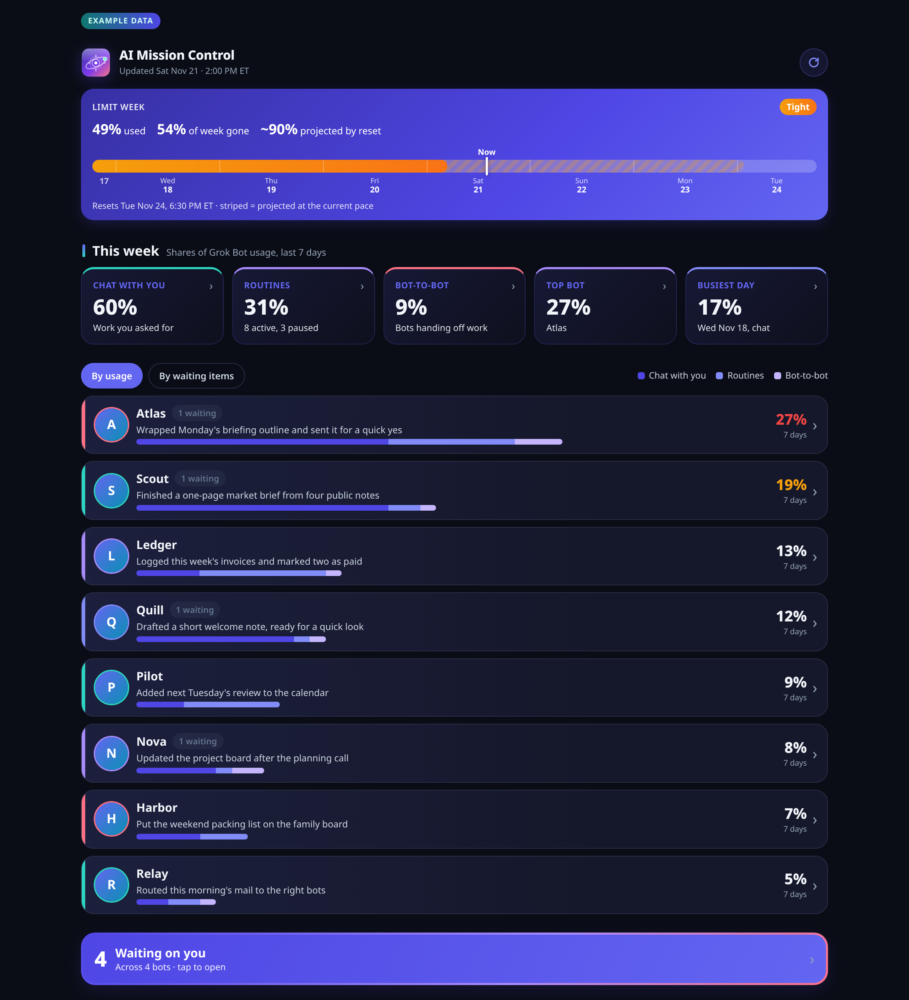
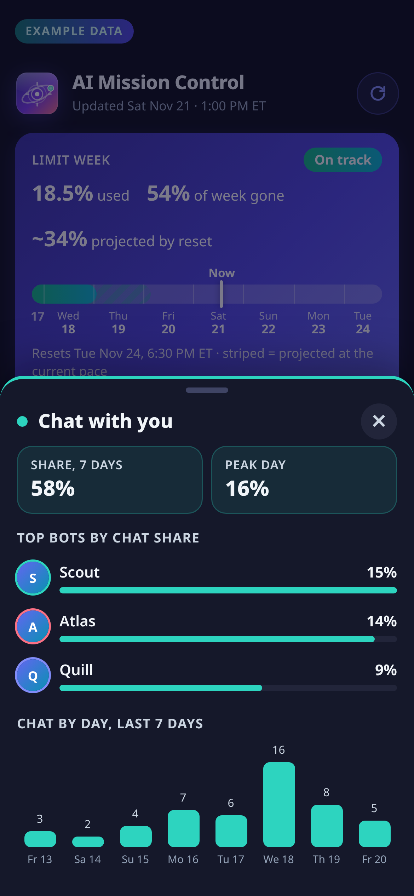
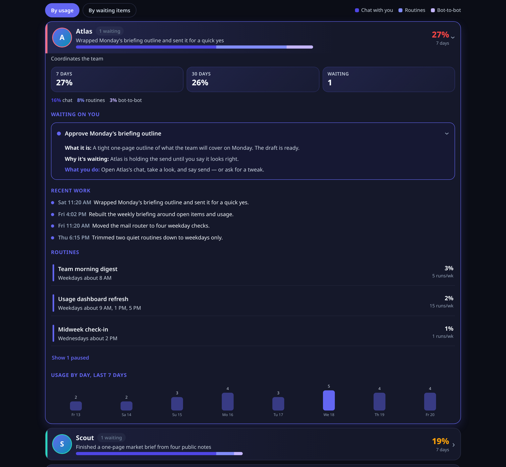
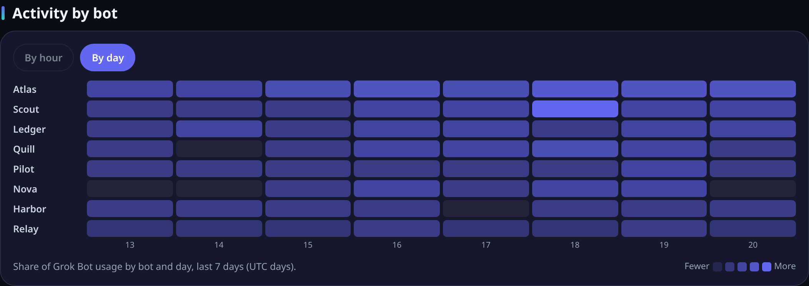
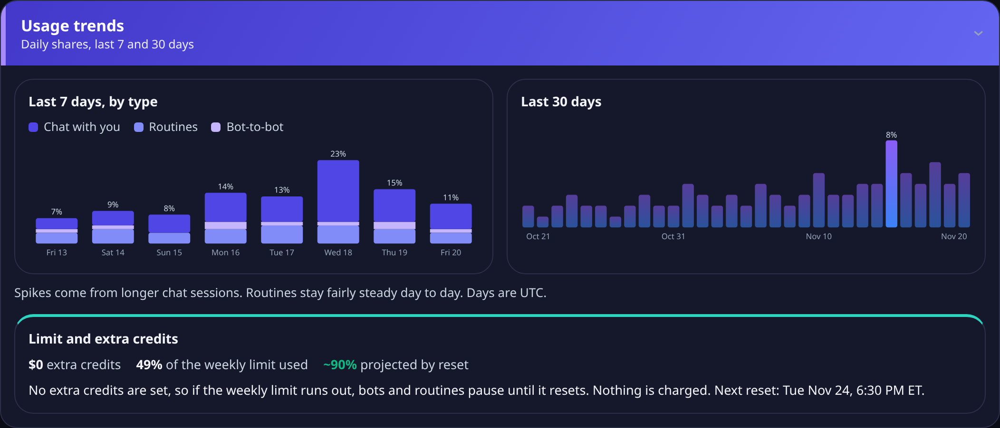
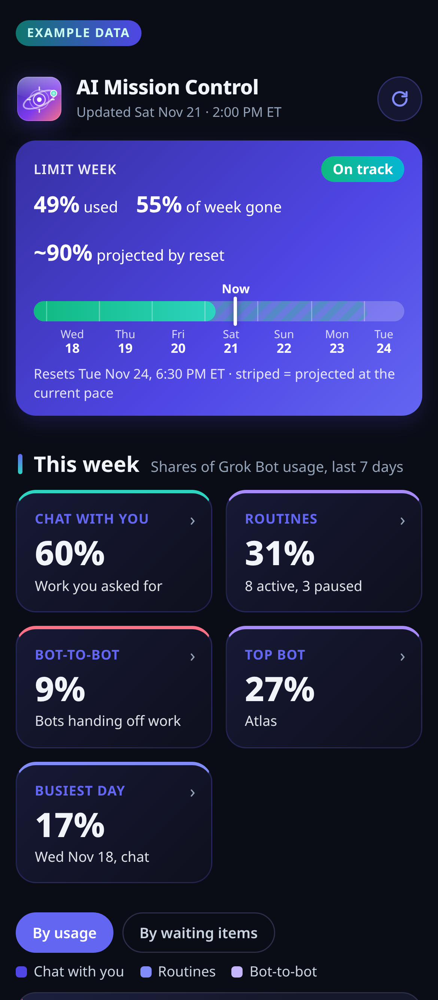
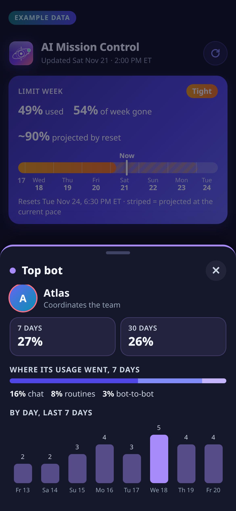

# AI Mission Control

A mobile-first dashboard for a team of [Grok Bots](https://x.ai): weekly usage against the limit, what each bot has been doing, and what is waiting on you.

This repository ships a **single self-contained page** and the prompts to rebuild it as a private Grok Bot Page. The screenshots and committed data are **invented example numbers and made-up bots**. Nothing here is a real usage report.

<em>Example week: 49% used with 54% of the week gone, paced to finish around 90% of the limit. The striped band is the projection at the current pace; the Now marker moves by the hour.</em>

## Tap a tile for the story

Each This week tile stays visually neutral — red and green are reserved for issues or elevation. Tap one and a panel slides up with a little more detail, not a whole new page.

<em>The Top bot tile opens on Atlas: 27% of the last 7 days, where that usage went, and the mid-week peak.</em>

## Open a bot in place

Expand any row for the usage mix, waiting items, recent work, and routines. Paused routines stay hidden until you ask for them.

<em>Atlas, expanded: a briefing outline ready for a yes, four recent items, three active routines, and usage by day.</em>

## Activity and trends

A heatmap of the last 7 days sits above the accordion. Open Usage trends for the last 7 and 30 days, plus where extra credits and the weekly limit stand.

## Built for a phone

The header stays compact: icon and title on the left, a small update time, and an icon-only refresh button. The same slide-up panel works with a thumb.

  
  &nbsp;
  

## What's on the page

- **Limit week** — percent used, how much of the week has gone, and a projected percent by reset. A Now marker moves by the hour. The striped band is the projection at the current pace.
- **This week tiles** — chat, routines, bot-to-bot, top bot, and busiest day. Tap one for a short slide-up. The tiles stay visually neutral.
- **Bot roster** — expand a bot in place for usage, recent work, waiting items, and routines.
- **Waiting on you** — one box, collapsed until you open it. Each item expands to what it is, why it is waiting, and what you do.
- **Activity by bot** — a heatmap of the last 7 days. By hour is offered only when real hourly data exists.
- **More** — an accordion for all routines, usage trends (including extra credits), and the limits of the data. Opening one section closes the others.

## Quick start

### In a browser

Open [`index.html`](index.html). There is no build step, no server, and no API key. Everything, including the example JSON, is inline. To refresh the screenshots after a design change, see `scripts/screenshot.sh`.

### As a private Grok Bot Page

1. Copy the prompt in [`prompts/build-prompt.md`](prompts/build-prompt.md) and paste it into a chat with your main Grok Bot.
2. The bot should build a **private** Page in this layout, using *your* usage report (ask for limit 20 so every bot is included), not the example numbers in this repo.
3. You can also paste [`canvas/MissionControl.tsx`](canvas/MissionControl.tsx) into a Page and then ask the bot to replace the example data blocks with your report.

A Grok Bot Page only runs inside Grok Bot. Another design model can edit the code in this repo, but it cannot live-preview that Page until your bot publishes it.

## How refresh works

Two scheduled routines refresh a live Page. They stay as separate jobs so their timing can be set independently. Both edit **data only** and leave the layout alone. See [`prompts/refresh-prompt.md`](prompts/refresh-prompt.md).

Both run hourly from 7 AM to 7 PM every day in your time zone:

1. **Numbers-only run** (on the hour) — pulls the plan usage report once (ask for up to 20 bots) and, in one batched edit, writes the snapshot time, the weekly limit block (percent used and reset time), and each bot's 7-day and 30-day share. It does not read chats or status files, and it does not sync routines. Prompt: [`prompts/numbers-refresh-prompt.md`](prompts/numbers-refresh-prompt.md).
2. **Status run** (on the half hour, so the two never edit the Page at the same time) — pulls the full usage report, syncs routines (active or paused per bot), honours the dismissed-items block and never shrinks it, keeps confidential or employer-sensitive work at area level, keeps investigation-type work to case references, strips any secrets, and reads each bot's status file instead of that bot's chat history. A missing or unreadable file is added to the gap notes; a file older than 3 days is flagged stale. Prompt: [`prompts/status-refresh-prompt.md`](prompts/status-refresh-prompt.md).

On the Page itself, pull-to-refresh and the Refresh button redraw in place so a home-screen app does not go blank. They cannot fetch new numbers on their own — they show the last saved snapshot. For a live Page, ask your bot to “update Mission Control,” or let the routines do it.

## Status files

Recent work and waiting items on a live Page come from a small JSON file that each bot maintains, not from reading chat histories. The shared skill [`skills/mission-control-status-file/SKILL.md`](skills/mission-control-status-file/SKILL.md) defines the format and the privacy rules.

- Path: `/workspace/mission-control/status/<agentId>.json`.
- Mapping: `/workspace/mission-control/bots.json` lists every bot in the fleet — including a trading or investing bot if you have one — with its agent id, Page key, and name. This repository ships an example at [`data/bots.example.json`](data/bots.example.json) that uses placeholders such as `<trader-agent-id>`. Do not commit real agent ids.
- Fields: `botId`, `bot`, `updated` (ISO 8601 with the user's offset), `last`, `recent` (up to 3 lines, newest first), and `waiting` items `{ t, what, why, todo }`. An example file is at [`data/status/example-atlas.json`](data/status/example-atlas.json).
- Write to a temp file in the same folder, then move it over the real file, and validate it with `jq` or `python3 -m json.tool`.
- Each bot keeps a standing rule: whenever an item waiting on the user is added, answered, completed or dropped, or at the end of a turn with notable work, it writes its file. It skips the write when nothing changed.
- Never put secrets, passwords, tokens, codes, or card or account numbers in the file. Confidential work stays at area level. Investigation work uses case references only.

## Privacy

This public template must stay free of personal data:

- Committed bots (Atlas, Scout, Ledger, Quill, Pilot, Nova, Harbor, Relay) and every number in `data/example.json` are invented and labelled as example data.
- Do not commit real usage percents, real bot names, people, organisations, emails, canvas IDs, tokens, live avatar assets, or real agent ids.
- Real data belongs in a private Page, or in a file such as `data/private.json` that is gitignored.
- Before every push, run `scripts/leak-check.sh`. `scripts/install-hooks.sh` installs a pre-push hook that does the same and blocks the push if anything is flagged.

If you publish your own Page for others, ship a copy that still uses mock data, the way this repo does.

## What's in the repo

| Path | What it is |
| --- | --- |
| `index.html` | Standalone page, all CSS and JS inline, example data embedded |
| `canvas/MissionControl.tsx` | Same layout as a Grok Bot Page source |
| `data/example.json` | The example dataset (must match the embedded block) |
| `data/SCHEMA.md` | Field-by-field schema |
| `docs/` | Desktop, mobile, tile-popup, expanded-bot, heatmap, and trends screenshots |
| `prompts/` | Build, numbers-only refresh, status refresh, and customize prompts |
| `skills/mission-control-status-file/` | Shared skill for the status-file format, write method, and privacy rules |
| `data/bots.example.json` | Example agent-id → bot-key mapping (placeholders only) |
| `data/status/example-atlas.json` | Example status file with invented data |
| `AGENTS.md` | Instructions for AI agents that edit or publish this |
| `scripts/leak-check.sh` | Denylist + gitleaks + trufflehog |
| `scripts/install-hooks.sh` | Pre-push hook installer |
| `LICENSE` | MIT, copyright AI Mission Control contributors |

## Customize

For a design tweak on a live Page, use [`prompts/customize-prompt.md`](prompts/customize-prompt.md) so the data blocks stay untouched. Design rules are listed in [`AGENTS.md`](AGENTS.md).

## License

[MIT](LICENSE) © AI Mission Control contributors.
